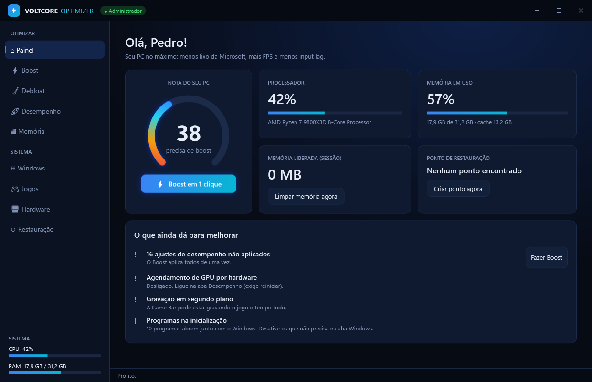
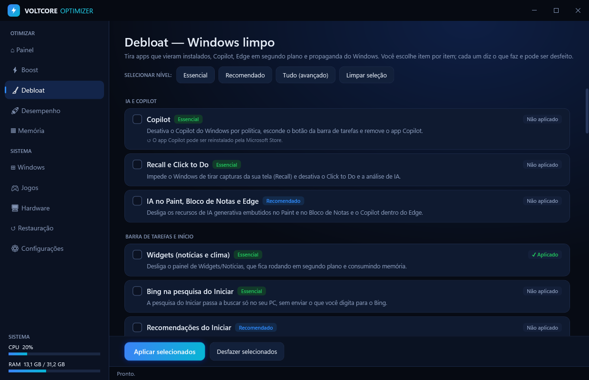
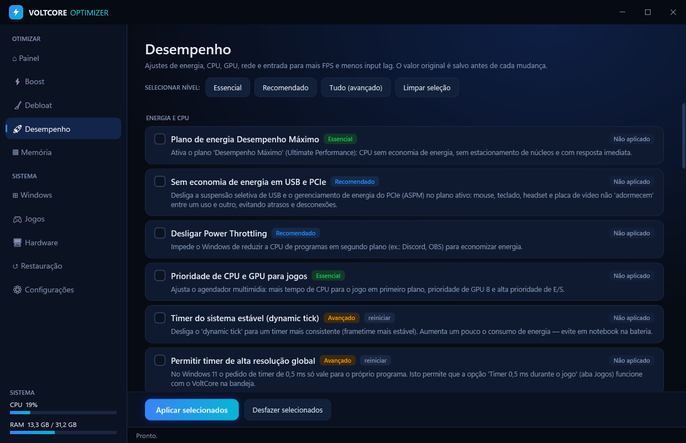
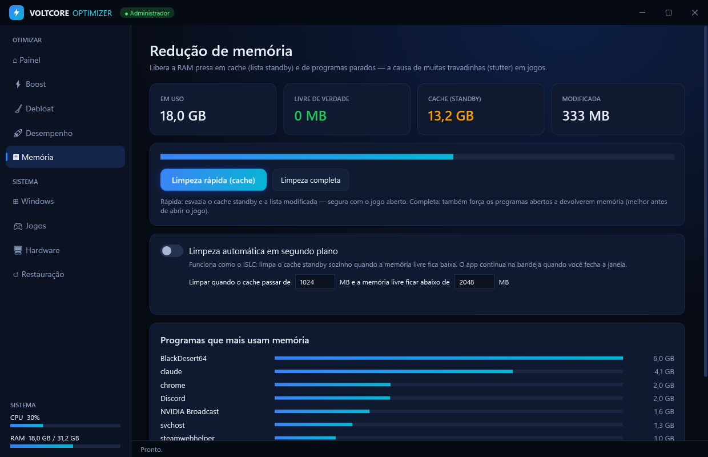
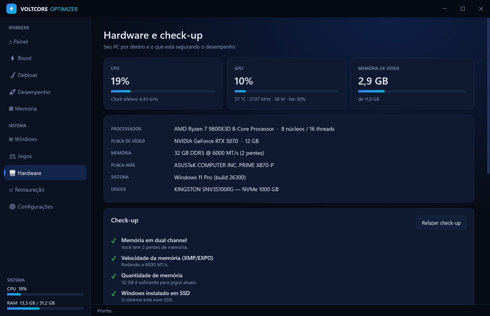

# ⚡ VoltCore Optimizer

Otimizador para **PC gamer** no Windows 10/11: debloat do lixo da Microsoft (Copilot, Recall, Edge, Widgets, telemetria, propagandas), ajustes de desempenho para mais FPS e menos input lag, e **redução de memória** automática — tudo num app só, com **1 clique** e **tudo reversível**.



## Recursos

| Aba | O que faz |
|---|---|
| **Painel** | Nota do PC (0–100), CPU/RAM ao vivo, memória liberada, último ponto de restauração e o que ainda dá para melhorar. **Aviso quando o Windows Update desfaz ajustes**, com reaplicar em 1 clique (também avisa na bandeja). |
| **Boost** | 1 clique: cria ponto de restauração → aplica todos os ajustes recomendados → limpa temporários e memória → mostra a nota subindo. |
| **Debloat** | Você escolhe item por item (níveis Essencial / Recomendado / Avançado): Copilot, Recall/Click to Do, IA no Paint/Bloco de Notas, Widgets, Bing no Iniciar, recomendações do Iniciar, telemetria (DiagTrack + tarefas), ID de anúncio, propagandas e apps patrocinados, Edge em segundo plano, **desinstalar Edge**, OneDrive, Teams, Clipchamp, Bing News/Clima, Solitaire, Office Hub e outros, e **serviços inúteis** (relatórios de erro, mapas offline, fax, registro remoto e, opcionalmente, impressão e Xbox Live) — só os que existem no seu PC. |
| **Desinstalar** | Desinstalador completo no estilo Revo: roda o desinstalador oficial, espera ele terminar (inclusive cópias temporárias de NSIS/Inno) e procura **sobras** em pastas (Program Files, ProgramData, AppData), atalhos, **registro** (chaves do programa e do fabricante, inicialização, App Paths), serviços e tarefas agendadas. Modos **Seguro / Moderado / Avançado**; dados do usuário nunca vêm marcados. Pastas vão para a **Lixeira** e o registro é **exportado em .reg** antes de apagar. **Remoção forçada** para programas com desinstalador quebrado. |
| **Desempenho** | Plano *Desempenho Máximo*, **sem economia de energia em USB/PCIe**, **placa de rede em baixa latência** (sem EEE/Green Ethernet/moderação de interrupções), **Integridade de Memória (HVCI/VBS)** opcional, sem Power Throttling, prioridade de CPU/GPU para jogos (MMCSS), Modo de Jogo, sem Game DVR, HAGS, otimizações para jogos em janela, aceleração do mouse desligada, sem Teclas de Aderência, Nagle desligado, sem limitação de rede, sem P2P de atualizações, apps em segundo plano, SysMain, indexação, inicialização rápida, hibernação, dynamic tick. |
| **Memória** | Mostra RAM em uso, livre de verdade, **cache standby** e lista modificada. Limpeza rápida (standby, segura com jogo aberto) ou completa (working sets). **Limpeza automática** estilo ISLC com limites configuráveis, rodando na bandeja. |
| **Windows** | Inicialização limpa (liga/desliga sem desinstalar), limpeza de disco com tamanho antes de limpar (temp, Windows Update, Otimização de Entrega, relatórios de erro, miniaturas, cache de shaders, Lixeira), reparo (SFC, DISM, componentes, rede/DNS) e **revisão semanal** agendada. |
| **Jogos** | Detecta jogos da Steam e Epic. Por jogo: prioridade alta, GPU de alto desempenho, sem otimizações de tela cheia, **núcleo 0 livre** e limpeza de memória ao abrir. **Sessão de jogo** automática: timer do Windows em **0,5 ms** e fechamento de programas em segundo plano enquanto o jogo está aberto — tudo volta ao normal quando o jogo fecha. **Teste de FPS antes/depois** com o PresentMon oficial da Intel (FPS médio, 1% low, 0,1% low, comparação em %; o PresentMon é baixado do GitHub oficial na primeira vez e conferido pelo SHA-256). Exclusão das pastas dos jogos no **Windows Defender** (menos travadas ao carregar) e **guia de input lag** adaptado à sua placa (Reflex/Anti-Lag, G-SYNC/FreeSync, limite de FPS calculado para o seu monitor). |
| **Rede** | Ping, **oscilação (jitter)** e **perda de pacotes** ao mesmo tempo para o roteador, Cloudflare, Google e o servidor do jogo, com gráfico e diagnóstico: problema no cabo/Wi-Fi (já aparece no roteador) ou no provedor (só na internet). |
| **Hardware** | **Teste de polling do mouse** (125/500/1000/… Hz), **estabilidade do cabo de rede** (registra cada troca de velocidade e queda, com horário — o driver Realtek não grava isso no log do Windows), **monitor ao vivo** (uso e clock efetivo da CPU, uso da GPU, VRAM, e temperatura/clock/consumo/fan em placas NVIDIA), CPU, GPU, RAM (tipo, velocidade, pentes), placa-mãe, discos (NVMe/SSD/HDD) e **check-up com correção em 1 clique**: monitor abaixo da taxa máxima, Resizable BAR, cabo de rede abaixo da velocidade da placa, HPET forçado, Integridade de Memória, dual channel, XMP/EXPO, SSD, espaço livre, plano de energia, HAGS, Game DVR, inicialização. |
| **Restauração** | Criar/listar pontos de restauração, abrir a Restauração do Sistema e **desfazer todos os ajustes** do app. |
| **Configurações** | **Iniciar com o Windows** minimizado na bandeja (via tarefa agendada, sem pedir UAC toda vez) e escolher se fechar a janela mantém o app na bandeja. |

<p>
 
 
</p>

## Segurança e reversão

- **Antes de cada mudança no registro o valor original é salvo** em `%ProgramData%\VoltCore\backup.tsv`. "Desfazer" restaura exatamente o que estava antes.
- Apps removidos (AppX) são reinstaláveis pela Microsoft Store; Edge e OneDrive voltam pelo `winget`.
- Itens **Avançado** pedem confirmação. Nada é aplicado sem você clicar.
- Registro de tudo que foi feito: `%ProgramData%\VoltCore\log.txt` (botão na aba Restauração).
- O Boost cria um **ponto de restauração do Windows** antes de começar.

## Como usar

Baixe o `VoltCore.exe` em **Releases** (ou em *Actions → build → Artifacts*) e execute. O app pede permissão de administrador, que é necessária para alterar o sistema.

> O Windows SmartScreen pode avisar por ser um executável não assinado: clique em *Mais informações → Executar assim mesmo*.

## Compilar

Não precisa de Visual Studio nem .NET SDK — usa o compilador C# que já vem no Windows (.NET Framework 4.8):

```bat
build.bat
```

Gera `dist\VoltCore.exe`. Para regenerar o ícone: `python assets\make_icon.py` (requer `opencv-python`).

Parâmetros de linha de comando:

- `--tray` — inicia escondido na bandeja (usado pelo início automático).
- `--maintenance` — executa a revisão semanal (limpeza + memória) sem abrir a janela; usado pela tarefa agendada.
- `--screenshots <pasta>` — salva um PNG de cada tela (usado para esta documentação).

## Estrutura

```
src/
  App.cs           entrada, instância única, modo manutenção
  MainWindow.xaml  interface (tema, estilos, telas)
  MainWindow.cs    lógica da interface, bandeja, timers
  Catalog.cs       todos os ajustes de debloat e desempenho
  TweakEngine.cs   aplicar/desfazer com backup do registro
  Memory.cs        limpeza de memória (standby, modificada, working sets)
  SystemTools.cs   inicialização, limpeza de disco, pontos de restauração, revisão semanal
  Games.cs         detecção Steam/Epic, ajustes por jogo, vigia de processos
  Hardware.cs      informações de hardware, check-up e nota do PC
  Uninstaller.cs   lista de programas, desinstalação, varredura e remoção de sobras com backup
  Tools.cs         ping/jitter/perda, teste de FPS (PresentMon), teste de polling do mouse
  Latency.cs       monitores/Hz, energia USB/PCIe, placa de rede, Defender, HPET/HVCI/ReBAR
  Monitor.cs       monitor ao vivo (PDH + nvidia-smi), timer 0,5 ms, iniciar com o Windows, sessão de jogo
```

## Aviso

Use por sua conta e risco. Os ajustes são os mesmos amplamente usados pela comunidade, mas cada PC é diferente — por isso tudo é reversível e há ponto de restauração.
